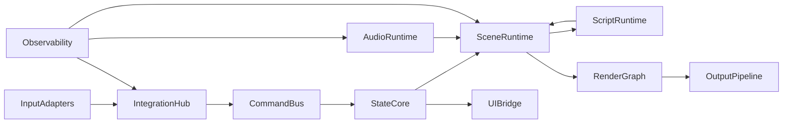

# Runtime Architecture Blueprint

## Objective
Define the end-to-end runtime topology for deterministic scene execution, low-latency responsiveness, and fault isolation.

## Topology

## Core Components
- **StateCore**
 - Canonical state for scene, controls, presets, playlist, mappings.
 - Command validation and commit semantics.
- **SceneRuntime**
 - Scene lifecycle (`load`, `start`, `pause`, `stop`, `switch`).
 - Binds schema, render graph, script runtime, and audio uniforms.
- **RenderGraph**
 - Deterministic pass scheduler.
 - Target allocation and pass execution instrumentation.
- **ScriptRuntime**
 - Sandboxed script hook execution.
 - Controlled host APIs and event callbacks.
- **AudioRuntime**
 - Analysis pipeline and reactive uniform publication.
- **IntegrationHub**
 - Converts protocol events to canonical commands and outgoing route updates.
- **Observability**
 - Frame, latency, memory, error, and protocol health telemetry.

## Frame Loop Ordering (Target)
1. Poll adapters and queue commands.
2. Validate and apply commands to canonical state.
3. Sample/advance audio analysis state.
4. Bind scene inputs and execute script `update(dt)`.
5. Execute render graph passes.
6. Publish output frame and telemetry.

## State Ownership Rules
- Only StateCore commits durable control/preset/playlist mutations.
- SceneRuntime may compute transient frame state but not durable preset state directly.
- ScriptRuntime never mutates stores directly; all changes flow through host APIs -> commands.

## Failure Containment Strategy
- Scene compile/script exceptions isolate to active scene context.
- Integration failures degrade adapter, not render loop.
- Audio device failure triggers fallback mode and surfaced diagnostics.
- Render pass failure triggers scene fallback or safe black frame policy.

## Observability Requirements
- Per-frame timings: command handling, script, audio, render passes, present.
- Pass-level stats: execution time, target resolution, format, allocation churn.
- Error channels with scene identifier and subsystem tag.

## Architecture Decisions Baseline
- Process/thread model: `adr/ADR-006-thread-and-process-model.md`.
- GPU backend strategy: abstraction baseline in `adr/ADR-002-rendering-backend.md`; backend selection and color/GPU policy in `adr/ADR-011-rendering-backend.md`.
- Warm-switch strategy: `adr/ADR-007-scene-warm-switch-policy.md`.
- Transition/traveler timing semantics: `adr/ADR-008-transition-and-traveler-semantics.md`.
- Contract baseline pack: `28-implementation-contract-pack.md`.
