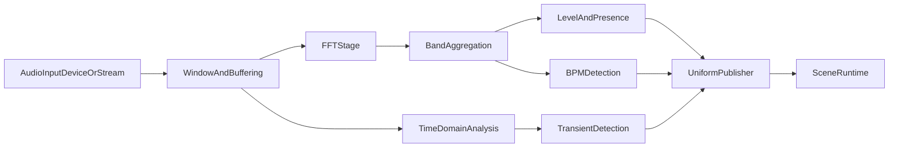

# Audio Engine Blueprint

## Objective
Specify the audio analysis architecture and reactive contract required for scene parity and live responsiveness.

## Responsibilities
- Capture or receive audio stream input.
- Perform spectral and temporal analysis.
- Publish stable reactive scalar uniforms and data textures.
- Maintain low-latency, low-jitter delivery to render loop.

## Output Contract Families
- **Level**: whole + band levels.
- **Hits**: transient-detection outputs.
- **Time**: activity-driven clocks.
- **Presence**: sustained energy indicators.
- **Beat/BPM**: pulse, confidence, and waveform-like BPM utilities.
- **Large features**: fade/intensity dynamics.
- **Data textures**: FFT/waveform/history channels.

## Pipeline

## Timing Model
- Audio analysis runs at fixed cadence with bounded drift per Sec.7.1.
- Uniform publication uses the snapshot-handoff contract in Sec.7.11 and `28-implementation-contract-pack.md` CP-02a.
- No direct per-pass audio recomputation in render path; all passes in a frame observe one snapshot.

## Reliability/Fallback Policy
- On audio device failure:
 - preserve runtime,
 - surface warning,
 - fall back to silent/default reactive outputs.
- On unstable BPM confidence:
 - degrade BPM-derived outputs gracefully, do not produce erratic spikes.

## Configuration Surface
- Input device selection and channel policy per `FR-11` and `30-mvp-support-matrix.md`.
- Band boundary configuration: default values in Sec.7.3; alternate profiles require ADR + profile bump.
- Smoothing constants and sensitivity profiles: baseline values locked in Sec.7; operator sensitivity is a single `Audio Sensitivity` scalar `[0.5, 2.0]` that multiplies `L_norm` before smoothing (does not change `EV-AUDIO-TRACE` fixtures which pin sensitivity to `1.0`).
- `_Audio_Speed` meta (post-MVP per `30-mvp-support-matrix.md`) multiplies the `dt` passed to time integrators in Sec.7.6.

## Validation Requirements
- Golden audio fixtures with expected uniform traces.
- Statistical validation for hit detection and BPM confidence behavior.
- Latency measurements from input sample to published frame uniform.

## 7) Normative Analysis Spec (MVP)

This section locks the numeric behavior of the audio pipeline. It is the single source of truth for `EV-AUDIO-TRACE`, `34-golden-corpus-definition.md` audio fixtures, and the drift tolerance families (`LVL`/`HIT`/`TIM`/`PRS`/`BEAT`/`BPM`/`LRG`) in `10-performance-latency-budgets.md`. The values are Chromaticity engineering decisions produced to match the observed reference behavior families; no reference numeric parameters are adopted.

### 7.1 Ingest and framing
- Canonical internal sample rate: `48000 Hz`. Inputs at `44100 Hz` are resampled (linear-phase FIR, 64-tap) to `48000 Hz` before analysis.
- Channel policy: multi-channel inputs are summed to mono with `1/sqrt(N)` gain before analysis. Per-channel routing is a presentation concern owned by `FR-11`.
- Analysis block size: `N_block = 512` samples (`10.667 ms` at 48 kHz).
- Hop size: `H = 128` samples (`2.667 ms`). Snapshot publish cadence is `48000 / 128 = 375 Hz`.
- Window: Hann, applied to each block. DC-removed via per-block mean subtraction before windowing.
- FFT size: `N_fft = 1024` (zero-padded). Frequency resolution `Deltaf = 48000 / 1024 ~= 46.875 Hz`.

### 7.2 Spectrum channels (`syn_Spectrum`)
Populated at each analysis hop; sampler is 1D with width `N_bins = 512` covering `[0, 24000) Hz`:
- **r - Raw FFT**: `|X[k]|` with no post-processing (zero-padded with linear magnitude).
- **g - Juiced FFT**: Raw FFT processed with, in order:
  1. Bin averaging over an asymmetric Gaussian kernel (sigma = 1.25 bins).
  2. Log-frequency remap: bin index `i` in `[0, N_bins)` samples frequency `f = 20 * (1000)^(i / (N_bins - 1))` (log-distributed 20 Hz -> 20 kHz).
  3. Temporal EMA smoothing: `g[i, t] = alpha_j * g_current[i] + (1 - alpha_j) * g[i, t-1]`, `alpha_j = 0.35` on rising, `0.15` on falling (asymmetric).
  4. High-end boost: multiply by `(1.0 + 0.6 * (i / (N_bins - 1))^1.5)`.
  5. Normalize to rolling 30 s p95 per-bin; clamp to `[0, 1]`.
- **b - Smooth FFT**: same pipeline as Juiced, but bin-averaged into `64` log-distributed bands before the EMA; resampled back to `N_bins` by linear interpolation.
- **a - Waveform**: raw time-domain samples from the most recent block, resampled to `N_bins` by linear interpolation and mapped to `[0, 1]` via `0.5 + 0.5 * x`.

### 7.3 Band aggregation
Bands are computed on the Juiced FFT using log-distributed edges:

| Band | Edge lo (Hz) | Edge hi (Hz) | Notes |
|---|---:|---:|---|
| Whole | 20 | 20000 | `syn_Level`, `syn_Hits`, `syn_Time`, `syn_Presence`, `syn_LevelTrail.r` |
| Bass | 20 | 250 | `syn_BassLevel`, `syn_BassHits`, `syn_BassTime`, `syn_BassPresence`, `syn_LevelTrail.g` |
| Mid | 250 | 2000 | `syn_MidLevel`, `syn_MidHits`, `syn_MidTime`, `syn_MidPresence`, `syn_LevelTrail.b` |
| MidHigh | 2000 | 6000 | `syn_MidHighLevel`, `syn_MidHighHits`, `syn_MidHighTime`, `syn_MidHighPresence` |
| High | 6000 | 20000 | `syn_HighLevel`, `syn_HighHits`, `syn_HighTime`, `syn_HighPresence`, `syn_LevelTrail.a` |

Band energy `E_b` at hop t is `sum(|X[k]|^2)` over bins in the band, divided by band bin count.

### 7.4 Level family (`syn_*Level`, family tolerance `LVL`)
- Raw level: `L_raw = sqrt(E_b)`.
- Rolling peak: 30 s windowed p95 of `L_raw`, refreshed each hop (`L_peak30`).
- Normalized level: `L_norm = clamp(L_raw / max(L_peak30, epsilon), 0, 1)` with `epsilon = 1e-4`.
- Smoothed level (asymmetric EMA): `L_smooth[t] = alpha_l * L_norm + (1 - alpha_l) * L_smooth[t-1]`, `alpha_l = 0.30` on rising, `0.08` on falling.
- Published uniform is `L_smooth[t]`.

### 7.5 Hits family (`syn_*Hits`, family tolerance `HIT`)
- Spectral flux per hop: `F_b[t] = sum(max(0, |X_b[k, t]| - |X_b[k, t-1]|))` over band bins (half-wave-rectified positive flux).
- Adaptive threshold: `theta_b[t] = median(F_b[t - W : t]) + k * MAD(F_b[t - W : t])` with window `W = 43` hops (~115 ms), `k = 1.5`.
- Refractory: `R_b = 19` hops (~50 ms) between hits per band.
- On detection (`F_b[t] > theta_b[t]` and no hit in past `R_b`): emit impulse `H_b = clamp(F_b[t] / max(theta_b[t], epsilon), 0, 1) * H_gain`, `H_gain = 0.8`.
- Published uniform decays per-frame: `hit_out[t] = max(H_b, hit_out[t-1] * exp(-dt / tau_h))`, `tau_h = 80 ms`.

### 7.6 Time family (`syn_*Time`, `syn_CurvedTime`, family tolerance `TIM`)
- Integration: `T_b[t] = T_b[t-1] + L_smooth[t] * dt` where `dt` is the hop period (`2.667 ms`).
- `syn_CurvedTime` (whole band): `T_curved[t] = T_curved[t-1] + L_smooth[t]^p * dt` with `p = 2.2` (exponential response to volume rises).
- Time uniforms are non-normalized, unit seconds-equivalent. They reset on scene load (like `TIME`) but persist across hot-reloads per `37-authoring-environment-spec.md` Sec.5.

### 7.7 Presence family (`syn_*Presence`, family tolerance `PRS`)
- Active-above-noise threshold: `L_smooth[t] > 0.08` counts the hop as "active".
- Slow EMA of active fraction: `P_b[t] = alpha_p * A_b + (1 - alpha_p) * P_b[t-1]`, `A_b in {0, 1}`, `alpha_p = 0.008` (~= 5 s time constant).
- Published uniform is `P_b[t]` in `[0, 1]`.

### 7.8 Beat family (`syn_OnBeat`, `syn_ToggleOnBeat`, `syn_RandomOnBeat`, `syn_BeatTime`, family tolerance `BEAT`)
- Beat detector input: whole-band spectral flux `F_w[t]` with a secondary low-frequency gate using the Bass band flux above `0.25 * theta_bass`.
- Detection: rising zero-crossing of `F_w[t] - theta_w[t]` with refractory `R_beat = 250 ms`.
- `syn_OnBeat`: impulse `1.0` on beat detection, decays `exp(-dt / tau_beat)`, `tau_beat = 90 ms`.
- `syn_ToggleOnBeat`: flips target between `0.0` and `1.0` on each beat; render value logistic-smoothed between targets over `180 ms`.
- `syn_RandomOnBeat`: on each beat, sample `rand() in [0, 1]`; logistic-smooth to new target over `180 ms`.
- `syn_BeatTime`: integer clock incremented by `1` on each detected beat (float-valued for GLSL parity).

### 7.9 BPM family (`syn_BPM*`, family tolerance `BPM`)
Two-stage estimator:
1. **Inter-onset interval stage**: maintain a rolling buffer of the last 48 beat-impulse timestamps (~24 s at 120 BPM). Compute the weighted median of successive intervals (weights linear with recency). Derived BPM `B_ioi = 60 / median_interval`.
2. **Autocorrelation refinement**: on a 4 s rolling window of `F_w[t]`, compute autocorrelation across lag range `[60/220, 60/50] s`. Peak lag `tau_ac` gives `B_ac = 60 / tau_ac`. Confidence `c_ac = r(tau_ac) / max(r)` where `r` is autocorrelation.
3. **Fusion**: if `c_ac > 0.35` and `|B_ac - B_ioi| < 6` then `B_final = 0.5 * (B_ac + B_ioi)`; otherwise `B_final = B_ioi`. Clamp to `[50, 220]`.
4. **Confidence**: `syn_BPMConfidence = 0.4 * c_ac + 0.6 * exp(-sigma_ioi / 8)` where `sigma_ioi` is the stddev of the weighted-interval buffer.

Derived waveforms use the beat-phase-locked clock:
- `syn_BPMTwitcher[t] = floor(beat_count) + 1 - exp(-5 * frac_in_beat)`, where `frac_in_beat in [0, 1]` is the phase since last beat normalized by beat period.
- `syn_BPMSin[t] = 0.5 + 0.5 * sin(2pi * phase)`; `syn_BPMSin2` at half-period; `syn_BPMSin4` at quarter-period (all `[0, 1]`).
- `syn_BPMTri[t] = 1.0 - |2 * phase - 1.0|` mapped to `[0, 1]`; `syn_BPMTri2`/`syn_BPMTri4` similarly at half/quarter.

### 7.10 Large features (`syn_FadeInOut`, `syn_Intensity`, family tolerance `LRG`)
- Silence detector: `L_smooth_whole[t] < 0.05` for more than `0.8 s` triggers silence state.
- `syn_FadeInOut`: asymmetric EMA of silence-inverse with `alpha_fi_rise = 0.004` (`~30 s` time constant up), `alpha_fi_fall = 0.002` (`~60 s` down). Clamped `[0, 1]`.
- `syn_Intensity`: asymmetric accumulator of `L_smooth_whole[t]` minus a slow baseline (`10 min` EMA of `L_smooth_whole`); clamped `[0, 1]`, rises faster than falls (`alpha_int_rise = 0.006`, `alpha_int_fall = 0.0015`).

### 7.11 Cadence, snapshot handoff, and staleness bound
- Audio analysis thread runs continuously at the `375 Hz` hop cadence defined in Sec.7.1.
- On each hop, all uniform values in Sec.7.4-Sec.7.10 are updated and written into a lock-free triple-buffered "audio snapshot" structure versioned monotonically (see `28-implementation-contract-pack.md` CP-02a).
- The frame scheduler reads the most-recent-complete snapshot at frame start (before pass 0) and the Script Host receives the same snapshot view. All passes within a frame observe the same audio values (per-frame cadence for all symbols in `36-reactive-symbol-catalog.md` Sec.2).
- Max staleness: `max_audio_staleness = 1 / 375 Hz + frame_period = 2.67 ms + 16.67 ms ~= 19.3 ms` at 60 FPS. `EV-AUDIO-TRACE` "timing delta <= 1 frame" in `10-performance-latency-budgets.md` resolves to this bound.

### 7.12 Reference-surface supplemental uniforms (`syn_InputLevel`, `syn_RawLevel`, `syn_BassExpoCurve`, `syn_Threshold`)
These correspond to `36-reactive-symbol-catalog.md` Sec.2.10. Formulas:
- `syn_InputLevel[t] = L_raw[t] / max(L_peak30[t], epsilon)` published **unclamped** (range `[0, inf)`), where `L_raw` and `L_peak30` are the hop RMS and 30 s p95 defined in Sec.7.4. This is the pre-AGC, pre-normalization level; contrast with `syn_Level`, which is the clamped/smoothed `[0,1]` form.
- `syn_RawLevel[t] = syn_InputLevel[t]`. Two spellings for one semantic; both ship under `compat-syn-v1` and `native-chroma-v1` because the reference docs use `syn_RawLevel` while reference scenes use `syn_InputLevel`.
- `syn_BassExpoCurve[t] = pow(syn_BassLevel[t], 3.0)`. Exponential bass reactivity curve. Family tolerance `LVL`.
- `syn_Threshold = operatorSetting in [0,1]` (default `0.0`). When `L_raw[t] < syn_Threshold` the snapshot publishes zeroed `syn_Level*` and `syn_*Hits` families for that hop; Time/Presence/BPM families are unaffected (they already have their own gating). OSC exposure: inbound `/audio/threshold {float}` setter and outbound `/audio/threshold {float}` discovery emission, governed by `adr/ADR-013-networking-defaults-and-security.md` rate limits.

These four uniforms are family `LVL` for tolerance purposes (added as family `LVL` members in `10-performance-latency-budgets.md` drift table follow-up).

### 7.13 Determinism rules
- All smoothing constants, window lengths, buffer sizes, thresholds, and RNG seeds are pinned per compatibility profile (`compat-syn-v1`, `native-chroma-v1`) and logged into `EV-AUDIO-TRACE` run metadata.
- Deterministic replay requires: identical input waveform fixture, identical sample rate conversion path, identical RNG seed for `syn_RandomOnBeat`, pinned profile version.
- Any change to Sec.7.1-Sec.7.10 or Sec.7.12 constants is a profile bump per `22-compatibility-versioning-policy.md` and requires a regression diff report across the golden corpus.

### 7.14 `syn_PrimeBang` (Profile D - Differentiation, heuristic)
`syn_PrimeBang` is documented under `native-chroma-v1` and `compat-syn-v1` as a **heuristic differentiator**, not a behavior-cloned parity symbol. Formula:
- Input gate: rising edge of `syn_FadeInOut` (delta > `0.05` within a `2 s` window) AND a BPM confidence delta of `> 0.15` within the same window.
- Output: impulse `1.0` on gate trigger, decays `exp(-dt / tau_prime)`, `tau_prime = 400 ms`. Refractory: `8 s`.
- Acceptance criterion: fires on large-scale musical transitions in the test corpus as judged by the reviewer; not epsilon-matched to reference.

### 7.15 Relative reactive bands (`chroma_AudioBass`/`Mid`/`Treb` + `*_att`, ADR-024)
A `native-chroma-v1` quality layer that complements the raw `syn_*Level` family (Sec.7.4) with **MilkDrop-class auto-gain**: volume-independent relative band reactivity per `adr/ADR-024-audio-reactivity-analysis-model.md`.
- **Bands** — three perceptual macro-bands (butterchurn split): bass `20-320`, mid `320-2800`, treb `2800-11025` Hz, summed from the Hann-windowed FFT magnitudes of the rolling analysis window.
- **Auto-gain** — `band = instantaneous / long_avg` and `band_att = short_avg / long_avg`, centred on `~1.0` and volume-independent (the same response on a loud or quiet track). Two FPS-compensated EMAs: a short average (fast attack `0.2` / slower release `0.5` weight-on-old) and a slow long average (`0.9` startup for the first 50 blocks, then `0.992`). A near-silent long average (`< 1e-3`) reads the band at the neutral `1.0`.
- **Surface** — published on `AudioUniformSnapshot` (and its IPC payload) as `bass`/`mid`/`treb` + `bass_att`/`mid_att`/`treb_att`, each defaulting to the neutral `1.0` before audio arrives (a relative band is multiplicative, so the pre-roll baseline is `1.0`, not the raw axes' `0.0`). The stateful analyser (`engine/audio::ReactiveBands`) is driven by the producer runtime at the fixed analysis cadence; the pure `extract_uniform_snapshot` returns the neutral baseline.
- **Determinism** — pure function of the sample stream + elapsed time; not observed by `canonical_state_hash`. The AGC constants follow the Sec.7.13 profile-bump discipline (a `native-chroma-v1` analysis-path change).
- **Forthcoming (ADR-024)** — K-weighted LUFS, Mel/perceptual sub-bands, a hysteresis noise gate, and a dual raw/normalized surface land in subsequent increments, coordinated with the `adr/ADR-023` metering widening. The render-side `chroma_AudioBass`/… uniform exposure landed with the live GPU output window (Slice R-1c, `engine/render::scene_adapter::resolve_reactive_symbol`); the six relative-band symbols are catalogued in `36-reactive-symbol-catalog.md` Sec.2.12 (catalog v1.4.0).

## Open Questions
- GPU vs CPU acceleration opportunities for large FFT workloads (design-time choice tracked in `adr/ADR-011-rendering-backend.md` follow-ups).
